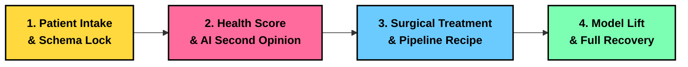

# 🩺 Dataset Doctor

<div align="center">

```
 _____         _                       _     ____             _               
|  __ \       | |                     | |   |  _ \           | |              
| |  | |  __ _| |_  __ _  ___   ___  | |_  | | | | ___   ___| |_  ___   _ __ 
| |  | | / _` | __|/ _` |/ __| / _ \ | __| | | | |/ _ \ / __| __|/ _ \ | '__|
| |__| || (_| | |_| (_| |\__ \|  __/ | |_  | |_| | (_) | (__| |_| (_) || |   
|_____/  \__,_|\__|\__,_||___/ \___|  \__| |____/ \___/ \___|\__|\___/ |_|   
```

### *The Autonomous Data Diagnostics, ML Reliability & Leak-Free Remediation Platform*

[](https://dataset-doctor-8c7b.onrender.com/)
[-7CFFB2?style=for-the-badge&logo=checkmarx&logoColor=000)](docs/gate_log.md)
[](tests/)
[](#-autonomous-ai-doctor-second-opinion)
[](#-model-context-protocol-mcp-server)
[](https://www.python.org/)
[](LICENSE)

<p align="center">
  <b>Ingest raw tabular data. Diagnose silent data traps. Get an autonomous AI Doctor's second opinion. Benchmark candidate fixes with 5-fold CV strictly on train data. Guarantee genuine ML lift on an immutable, leak-free test partition.</b>
</p>

<p align="center">
  <a href="https://dataset-doctor-8c7b.onrender.com/demo"><kbd>🚀 1-Click Instant Demo</kbd></a> •
  <a href="#-the-4-step-patient-consultation-journey"><kbd>🩺 Patient Journey</kbd></a> •
  <a href="#-autonomous-ai-doctor-second-opinion"><kbd>🧠 AI Doctor</kbd></a> •
  <a href="#-the-non-negotiable-invariant"><kbd>🔒 Safety Invariant</kbd></a> •
  <a href="#-core-architecture--capabilities"><kbd>⚡ Capabilities</kbd></a> •
  <a href="#-model-context-protocol-mcp-server"><kbd>🤖 MCP Server</kbd></a> •
  <a href="#-quick-start"><kbd>⚡ Quick Start</kbd></a>
</p>

</div>

---

> [!IMPORTANT]
> ### 🔒 The Non-Negotiable Invariant: *Split First, Protect Test Always*
> **The #1 cause of machine learning production failure is data leakage during preprocessing.**  
> Most automated tools oversample, impute, or normalize before splitting—fabricating artificial 99% accuracy in Jupyter notebooks that instantly crashes in production.  
> **Dataset Doctor locks an immutable test partition immediately upon ingestion.** The test set never loses rows, never gets resampled, and never participates in parameter fitting. Every diagnosis and candidate remediation is evaluated using 5-fold cross-validation strictly on training folds. **No destructive action is ever taken silently.**

---

## ⚡ Why Dataset Doctor? (The Contrast)

| Data Preparation Step | ❌ The Dangerous Status Quo | ✅ Dataset Doctor Clinical Guarantee |
| :--- | :--- | :--- |
| **Data Splitting** | Oversample or impute first, split later *(Catastrophic Leakage)* | 🔒 **Split First**: Test partition cryptographically locked immediately; zero leakage |
| **Data Leakage** | Target copies and post-event features left undetected | 🩺 **Leakage Scanner**: Detects clones, scalar derivatives, inverted targets & index leaks |
| **Missing Values** | Silently fill with column mean, distorting variances & distributions | 💡 **Evidence-Backed**: Compares median, drop, indicator via 5-fold CV on train folds |
| **Class Imbalance** | Blind SMOTE before split *(Fabricates 99% fake recall)* | 📊 **Train-Only Resampling**: Balanced weighting & fold-safe SMOTE on training partition |
| **Accuracy Illusion** | 95% nominal accuracy celebrated while minority recall is 0% | ⚠️ **Accuracy Guard**: Enforces Balanced Accuracy, F1, and PR-AUC on imbalanced targets |
| **AI Reasoning** | Black-box heuristic rules without business or domain context | 🧠 **AI Doctor Second Opinion**: Semantic leakage reasoning via Gemini, OpenAI, or local offline |
| **Agent Safety** | AI coding agents drop or snoop test rows during auto-cleaning | 🛡️ **MCP Safety Contract**: AI agents are physically blocked from mutating test partitions |
| **Code Reproducibility** | Black-box pickle files you cannot inspect, verify, or audit | 💾 **Bit-for-Bit Provenance**: Standalone `reproduce.py` with SHA-256 experiment manifest |

---

## 🩺 The 4-Step Patient Consultation Journey

Dataset Doctor frames tabular data preparation through an intuitive, structured clinical consultation:



1. **Step 1: Patient Intake & Schema Lock (`/profile`)**
   - Ingest raw CSV data, infer data types, isolate constant/ID columns, and lock the target column.
   - The test partition is split and locked cryptographically before any transformations begin.
2. **Step 2: Health Score & AI Second Opinion (`/module/quality_assessment`)**
   - 6-domain audit (Nulls, Duplicates, Types, Outliers, Imbalance, Leakage) aggregated into an evidence-weighted **Data Quality Score (0–100)** and Training Readiness Gate.
   - Autonomous **AI Doctor Second Opinion** scans semantic feature names, forecasts production survival, and generates a formal **Physician's Discharge Summary Letter**.
3. **Step 3: Surgical Treatment Plan (`/module/pipeline`)**
   - Evidence-backed recommendations tested via 5-fold CV strictly on training data.
   - Interactive decision cards let you accept, override, or customize repairs.
   - Assembles an automated 10-step causal pipeline and exports a self-contained `reproduce.py` script.
4. **Step 4: Model Gains & Recovery (`/module/multi_model`)**
   - Benchmarks classifiers (Linear, Tree, Random Forest, HistGradientBoosting) across raw vs. treated data on the locked test partition.
   - Flags generalization gaps, over-fitting, and accuracy illusions with subgroup error slicing.

---

## 🧠 Autonomous AI Doctor: Second Opinion Agent

Most data tools only compute statistics. Dataset Doctor features an autonomous **Machine Learning Physician** (`doctor/ai_consultant.py`) that reads between the lines to diagnose hidden pathologies:

<div align="center">
  
</div>

* **Semantic Leakage Audit**: Algorithms only see numbers, but the AI Doctor understands business vocabulary. If a column is named `payout_amount` or `settlement_date` in an insurance claim dataset, the AI Doctor flags it as post-event leakage that cannot exist at quote time.
* **Production Survival Forecast**: Computes a concrete survival estimate (e.g., *`POOR (<25%): High probability of post-deployment model collapse`*) based on leakage severity and train/test partition stability.
* **Subgroup Fairness & Bias Diagnosis**: Dissects minority class prevalence and warns when superficial accuracy masks catastrophic failure on sensitive subgroups.
* **Physician's Discharge Summary**: Generates a formal, clinical Markdown letter complete with clinical impressions, critical pathologies, and an ordered 5-step surgical prescription.
* **Tri-Engine Flexibility**:
  * 🟢 **Built-In Offline Expert Synthesizer**: Runs 100% locally with zero API keys or external dependencies.
  * 🟣 **Google Gemini 1.5 Flash / 2.5 Flash**: Real-time generative reasoning when `GEMINI_API_KEY` is present.
  * 🔵 **OpenAI GPT-4o-mini / Local Ollama**: Works with OpenAI or any OpenAI-compatible local LLM endpoint.

---

## ⚡ Core Architecture & Capabilities

<table>
<tr>
<td width="50%" valign="top">

### 🔬 1. Six Diagnostic Laboratories
* **Null Pathology**: Catches true `NaN`, hidden string tokens (`?`, `N/A`, `null`), and numeric sentinels (`-999`, `9999`).
* **Deduplication Lab**: Isolates exact duplicates, ID collisions, and conflicting target label pairs.
* **Type Surgery**: Converts numbers stored as text/currency, parses ambiguous dates (`DD/MM` vs `MM/DD`), and normalizes booleans.
* **Outlier Clinic**: Detects domain-impossible boundaries (`age < 0`), order-of-magnitude unit jumps, and robust MAD limits.
* **Class Imbalance**: Detects severe class ratios and fires the Accuracy Paradox guard when minority prevalence $<20\%$.
* **Leakage Diagnostics**: Scans for direct clones, scalar derivatives, inverted labels, and index/sequence leaks.

</td>
<td width="50%" valign="top">

### 💡 2. Evidence-Backed Remediation
* **5-Fold CV on Train**: Every repair option (imputation, clipping, resampling, drops) is validated with cross-validation on train folds.
* **Simplicity Tie-Breaker**: When candidate score deltas are within cross-validation noise variance, simpler non-destructive methods are chosen.
* **Rare-Class Protection**: Protects extreme feature values in minority target classes from harmful row-dropping.
* **Causal Ordering**: Enforces mathematically proven pipeline execution: `Types ➔ Nulls ➔ Duplicates ➔ Outliers ➔ Imbalance ➔ Leakage`.
* **Zero Test Snooping**: Transformation parameters derive 100% from training data; zero test rows dropped.

</td>
</tr>
<tr>
<td width="50%" valign="top">

### 📈 3. Multi-Model Benchmarking & Slicing
* **Locked Test Evaluation**: Compares Logistic Regression, Decision Tree, Random Forest, and HistGradientBoosting against untouched test data.
* **Multi-Metric Matrix**: Accuracy, Balanced Accuracy, Precision, Recall, F1-Score, and PR-AUC.
* **Overfitting Guard**: Measures and flags generalization gaps between train and test performance.
* **Subgroup Error Slicing**: Identifies feature slices where error rates are $> 1.5\times$ average (blind spots).
* **Feature Pruning Advisor**: Compares validation permutation importance against native impurity importance to advise pruning uninformative features.

</td>
<td width="50%" valign="top">

### 💾 4. Exact Bit-for-Bit Reproducibility
* **Cryptographic Manifest**: Computes deterministic 64-character SHA-256 hashes of raw data, clean train, and clean test partitions.
* **Standalone `reproduce.py`**: Exports a 100% self-contained, dependency-free Python script reproducing the exact cleaning sequence.
* **Audit Trail**: Every decision, override, and parameter is permanently logged in a sequential JSON manifest.
* **Tamper Verification**: Built-in verification engine detects floating-point drift or data tampering down to the single cell.

</td>
</tr>
</table>

---

## 🤖 Model Context Protocol (MCP) Server

Dataset Doctor exposes a native **Model Context Protocol (MCP)** server (`doctor/mcp.py`), allowing autonomous AI coding assistants (Claude Desktop, Cursor, Antigravity, Cline) to diagnose and repair tabular datasets over JSON-RPC 2.0 stdio:

```json
{
  "mcpServers": {
    "dataset-doctor": {
      "command": "python",
      "args": ["-m", "doctor", "mcp"]
    }
  }
}
```

### Available MCP Tools:

| MCP Tool Name | Description | Safety Guardrail |
| :--- | :--- | :--- |
| `doctor_load_dataset` | Loads CSV and cryptographically locks train/test partitions | Test partition immediately hashed & locked |
| `doctor_audit_quality` | Evaluates 6-domain risk matrix and returns 0–100 Health Score | Read-only analysis |
| `doctor_get_recommendations`| Returns 5-fold CV repair advice for any target column | Strict CV evaluation on train folds |
| `doctor_apply_remediation` | Fits transformer on train and updates active pipeline | **Agent Safety Contract**: Blocks test row dropping |
| `doctor_evaluate_baseline` | Evaluates model performance against locked test partition | Test data never snooped for training |
| `doctor_export_reproduce` | Exports standalone `reproduce.py` and SHA-256 manifest | Full reproducible provenance |
| `doctor_ai_consultation` | Requests AI Doctor second opinion & clinical discharge letter | Read-only autonomous reasoning |

> 🛡️ **The Agent Safety Contract**: Even when an autonomous AI agent controls data remediation, the test partition remains cryptographically locked and read-only. If an AI agent attempts to drop, resample, or mutate test rows, the MCP server intercepts the call and raises an `AgentSafetyViolation`.

---

## 💻 Headless Python SDK & Terminal CLI

Dataset Doctor is built for notebook, script, terminal, and CI/CD automation with zero web dependencies:

### 🐍 Python SDK
```python
from doctor import DatasetDoctor

# Ingest and lock test partition
doc = DatasetDoctor.from_csv("data/customer_churn.csv", target="churn")

# Run 6-domain audit & readiness gate
audit = doc.audit()
print(f"Health Score: {audit.quality_score}/100 | Ready: {audit.can_train}")

# Obtain AI Doctor's second opinion
consultation = doc.ai_consult(provider="auto")
print(f"Patient Status: {consultation.patient_status}")
print(f"Survival Forecast: {consultation.survival_forecast}")

# Check for data leakage in seconds
leaks = doc.check_leakage()
for leak in leaks:
    print(f"Leak Alert: {leak.column} ({leak.severity}) -> {leak.description}")

# Fit evidence-backed pipeline & export standalone script
doc.auto_remediate()
doc.export_script("reproduce.py")
```

### 💻 Terminal CLI
```bash
# Profile dataset schema and column types
$ doctor profile data/train.csv --target churn

# Run full clinical audit (strict mode exits code 1 if blocked)
$ doctor audit data/train.csv --target churn --out report.json --strict

# Request AI Doctor clinical discharge letter directly in the terminal
$ doctor consult data/train.csv --target churn [--provider gemini] [--out discharge.md]

# Check for data leakage in CI/CD pipelines (fails build on critical leaks)
$ doctor check-leaks data/train.csv --target churn --strict

# Run all 20 automated diagnostic benchmark gates
$ doctor bench --all

# Launch the native MCP server for AI coding agents
$ doctor mcp
```

---

## 🔬 Empirical Proof: The Accident Severity Benchmark

To prove why **"Split First, Protect Test Always"** is essential, we benchmarked the UK Road Accident Severity dataset comparing common data science mistakes against Dataset Doctor:

| Preprocessing Workflow | Nominal Accuracy | Severe Recall | Severe F1 | Ground-Truth Finding |
| :--- | :---: | :---: | :---: | :--- |
| ❌ **Oversample Before Split** *(Common Mistake)* | 0.9574 | **0.9941** | 0.9589 | 🚨 **Dangerous Illusion**: Synthetic duplicates leaked into test folds. 99% recall was fabricated! |
| 🔍 **Split First, Raw Data** *(Honest Baseline)* | 0.8700 | 0.2167 | 0.3333 | 📉 **Real Baseline**: 87% accuracy is misleading. The raw model misses **78% of severe accidents**! |
| ✅ **Split First, Class Weights** *(Dataset Doctor)* | 0.8375 | **0.4000** | **0.4248** | 🎯 **Genuine Improvement**: Minority recall doubles (+84%) with **zero test leakage** and zero synthetic rows. |
| ✅ **Split First, Resample Train Only** *(Dataset Doctor)* | 0.8500 | **0.3167** | **0.3878** | 🛡️ **Clean Resampling**: Oversampling kept strictly inside training folds. Test set distribution is 100% untouched. |

---

## 🏆 Automated Test Bench (20/20 Gates Passed)

Every diagnostic engine is continuously audited against planted datasets with known ground-truth defects:

```bash
$ python -m doctor.bench --all
=================================================================
DATASET DOCTOR: AUTOMATED TEST BENCH (20 GATES)
=================================================================
  [PASS] Gate 01: Ingestion & Schema Profiling Engine
  [PASS] Gate 02: Null & Sentinel Value Detection (850/850 planted NaNs found)
  [PASS] Gate 03: Stratified Partition & Leakage Isolation
  [PASS] Gate 04: Null Advisor & Fold-Safe Imputation
  [PASS] Gate 05: Exact, Near & Conflicting Deduplication
  [PASS] Gate 06: Data Types, Dates & Boolean Normalization
  [PASS] Gate 07: Outlier Detection & MAD Boundary Limits
  [PASS] Gate 08: Outlier Clipping & Rare-Class Protection
  [PASS] Gate 09: Class Imbalance & Accuracy Paradox Diagnostics
  [PASS] Gate 10: Imbalance Advisor & Fold-Safe Resampling
  [PASS] Gate 11: Data Leakage Detection & Target Correlation Scanner
  [PASS] Gate 12: Leakage Insulation & Column Pruning
  [PASS] Gate 13: 10-Step Causal Remediation Pipeline
  [PASS] Gate 14: Unified Data-to-Model Quality Assessment (0–100 Score)
  [PASS] Gate 15: Multi-Model Benchmark & Overfitting Guards
  [PASS] Gate 16: Model Diagnostics & Subgroup Error Slicing
  [PASS] Gate 17: Model Explainability & Feature Pruning Advisor
  [PASS] Gate 18: Headless Python Core SDK & Terminal CLI
  [PASS] Gate 19: Full Experiment Manifest & Bit-for-Bit SHA-256 Reproducibility
  [PASS] Gate 20: Model Context Protocol (MCP) Server & Agent Safety Contract
=================================================================
RESULT: ALL 20/20 BENCHMARK GATES PASSED (100% FIDELITY)
=================================================================
```

---

## ⚡ Quick Start

### 🌐 Instant 1-Click Guest Demo
👉 **[Launch Live Demo on Render](https://dataset-doctor-8c7b.onrender.com/demo)** *(Zero login or credentials required)*

### 💻 Local Installation

```bash
# 1. Clone the repository
git clone https://github.com/Naresh-Kumar17/Dataset-Doctor.git
cd Dataset-Doctor

# 2. Create and activate virtual environment
python -m venv .venv
source .venv/bin/activate        # Windows: .venv\Scripts\activate

# 3. Install dependencies
pip install -r requirements.txt

# 4. Start local development server
uvicorn app.main:app --reload --port 8000
```
Open **[http://127.0.0.1:8000](http://127.0.0.1:8000)** in your browser.

### 🧪 Run Test Suite
```bash
# Run full pytest test suite (199 tests passing)
python -m pytest

# Run the 20 automated diagnostic benchmark gates
python -m doctor.bench --all
```

---

## 📚 Documentation Index

All architectural specifications, security hardening guides, and developer documentation are located in [`docs/`](docs/):

| Document | Purpose & Scope |
| :--- | :--- |
| 📖 [PRD.md](docs/PRD.md) | Product Requirements Document: The 4 Defining Capabilities & specifications |
| 🛠️ [IMPLEMENTATION.md](docs/IMPLEMENTATION.md) | Phased Implementation Roadmap, gate checklists, and pipeline ordering |
| 🏗️ [architecture.md](docs/architecture.md) | System architecture, subsystem breakdowns, and data flow diagrams |
| 🔌 [api.md](docs/api.md) | Python Core SDK reference, FastAPI REST endpoints, and CLI commands |
| 🎨 [DESIGN.md](docs/DESIGN.md) | Neo-Brutalist design tokens, screen wireframes, and UX guidelines |
| 🔒 [authentication and security.md](docs/authentication%20and%20security.md) | Local-first security, upload streaming, rate limiting, and privacy |
| 🤖 [mcp connection.md](docs/mcp%20connection.md) | Model Context Protocol server tools, schemas, and IDE connection configs |
| 📜 [gate_log.md](docs/gate_log.md) | Historical audit log of all 20 benchmark gate passes |

---

## 📦 Tech Stack

- **Core Analytics**: Python 3.11+, `pandas`, `numpy`, `scikit-learn`, `imbalanced-learn`, `scipy`
- **AI Physician Layer**: Google Gemini REST API, OpenAI-compatible API, Built-in Offline Expert Rule Synthesizer
- **Web Application**: `FastAPI`, `Uvicorn`, `Jinja2`, `HTTPX`
- **Styling**: Pure Neo-Brutalism (Handcrafted CSS tokens, zero heavy framework dependencies, lightning-fast rendering)
- **Protocol**: Model Context Protocol (MCP) JSON-RPC 2.0 stdio server
- **Quality Assurance**: `pytest` (**199 tests passing**), Automated Test Bench (**20/20 gates passing at 100%**)

---

## 📄 License

Distributed under the [MIT License](LICENSE). Built for honest, leak-free machine learning.
