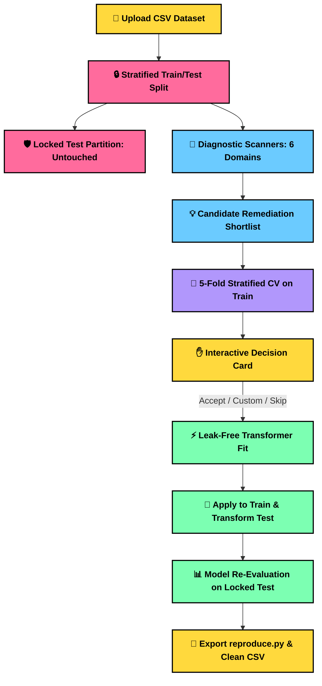

# 🩺 Dataset Doctor

<div align="center">

```
 _____         _                       _     ____             _               
|  __ \       | |                     | |   |  _ \           | |              
| |  | |  __ _| |_  __ _  ___   ___  | |_  | | | | ___   ___| |_  ___   _ __ 
| |  | | / _` | __|/ _` |/ __| / _ \ | __| | | | |/ _ \ / __| __|/ _ \ | '__|
| |__| || (_| | |_| (_| |\__ \|  __/ | |_  | |_| | (_) | (__| |_| (_) || |   
|_____/  \__,_|\__|\__,_||___/ \___|  \__| |____/ \___/ \___|\__|\___/ |_|   
```

### *The Data-to-Model Quality, ML Reliability & Leak-Free Remediation Platform*

[](https://dataset-doctor-8c7b.onrender.com/)
[-7CFFB2?style=for-the-badge&logo=checkmarx&logoColor=000)](docs/gate_log.md)
[](tests/)
[](https://www.python.org/)
[](LICENSE)
[](docs/authentication%20and%20security.md)

<p align="center">
  <b>Upload raw tabular data. Uncover silent data traps. Benchmark repairs with 5-fold CV strictly on train data. You decide. Verify genuine ML gains on an immutable test partition.</b>
</p>

<p align="center">
  <a href="https://dataset-doctor-8c7b.onrender.com/"><kbd>🌐 Launch Live Web App</kbd></a> •
  <a href="#-master-phase-tracker"><kbd>🚦 Core Phase Tracker</kbd></a> •
  <a href="#-upcoming-features-spotlight"><kbd>🔮 Upcoming Features</kbd></a> •
  <a href="#-interactive-decision-cards"><kbd>🗂️ Decision Cards</kbd></a> •
  <a href="#-empirical-proof-the-accident-study"><kbd>🔬 The Proof</kbd></a> •
  <a href="#-quick-start"><kbd>⚡ Quick Start</kbd></a> •
  <a href="#-documentation-index"><kbd>📚 Docs</kbd></a>
</p>

</div>

---

> [!IMPORTANT]
> **The Non-Negotiable Invariant**: **Split first. Fix training data only.**  
> The test set is locked immediately upon CSV upload. It is never resampled, never loses rows, and never participates in parameter estimation. Every remediation is evaluated using 5-fold cross-validation on training data, and **no destructive action is ever taken silently**.

---

## ⚡ Why Dataset Doctor? (The Contrast)

Most automated cleaning tools silently corrupt machine learning benchmarks through data leakage, arbitrary row dropping, and misleading accuracy metrics. Dataset Doctor guarantees mathematical honesty:

| Workflow Step | ❌ The Dangerous Status Quo | ✅ Dataset Doctor Guarantee |
| :--- | :--- | :--- |
| **Data Splitting** | Oversample / impute first, split later *(Massive Test Leakage)* | 🔒 **Split First**: Test partition locked immediately; zero leakage |
| **Missing Values** | Silently fill with overall mean, distorting variances | 💡 **Evidence-Backed**: Compares median, drop, indicator via 5-fold CV |
| **Duplicates** | Blind `drop_duplicates()` discarding minority classes | ⚖️ **Target-Aware**: Flags conflicting labels; protects minority rows |
| **Outliers** | Unchecked 3-sigma clipping discarding legitimate extremes | 🛡️ **Rare-Class Guard**: Preserves extreme values in minority outcomes |
| **Class Imbalance** | Blind SMOTE before split *(Fabricates 99% fake accuracy)* | 📊 **Train-Only Resampling**: Class weights & fold-safe SMOTE on train |
| **Auditing & Code** | Black-box pickle files you cannot audit or customize | 💾 **Reproducibility**: Exports standalone `reproduce.py` & audit trail |

---

## ✨ Core Capabilities

<table>
<tr>
<td width="50%" valign="top">

### 🔍 1. Diagnostic Discovery
- **Null Analysis**: Catches true `NaN`, hidden string tokens (`?`, `N/A`, `null`), and numeric sentinels (`-999`, `9999`).
- **Deduplication**: Isolates exact duplicates, identifier collisions, and conflicting target label pairs.
- **Data Types**: Identifies numbers stored as currency/text, ambiguous dates (`DD/MM` vs `MM/DD`), and binary booleans.
- **Outlier Defense**: Detects domain-impossible boundaries (`age < 0`), order-of-magnitude unit jumps, and robust MAD tail limits.

</td>
<td width="50%" valign="top">

### 💡 2. Evidence-Backed Remediation
- **5-Fold CV on Train**: Compares candidate fixes (imputation, clipping, weighting, row drops) strictly on training data.
- **Simplicity Tie-Breaker**: When score differences are within noise variance, simpler non-destructive methods are chosen.
- **Rare-Class Protection**: Protects extreme feature values in minority target classes from harmful row-dropping.
- **Zero Test Snooping**: Transformation bounds (medians, clip limits, encodings) derive 100% from training data.

</td>
</tr>
<tr>
<td width="50%" valign="top">

### 📊 3. Metric Honesty
- **Accuracy Guard**: When minority class share is $< 20\%$, overall accuracy is labeled as unreliable.
- **Minority Metrics**: Prioritizes Recall, Precision, F1-score, and Precision-Recall AUC (PR-AUC).
- **Noise Verification**: Metric deltas smaller than cross-validation standard deviation are marked as *"Within Noise / Close Call"*.
- **Small Sample Guard**: Datasets with $N < 500$ rows generate explicit *"Noisy Comparison"* warnings.

</td>
<td width="50%" valign="top">

### 💾 4. Exact Reproducibility
- **Decision Audit Trail**: Every accepted choice is recorded in a sequential, tamper-proof pipeline log.
- **Standalone `reproduce.py`**: Generates a self-contained Python script to replay the entire data cleaning sequence independently.
- **Cleaned CSV Export**: Downloads processed datasets with transformation metadata headers.
- **Zero Cloud Persistence**: Ephemeral in-memory sessions; your data never leaves your machine.

</td>
</tr>
</table>

---

## ⚙️ Interactive Lifecycle Workflow



---

## 🗂️ Interactive Decision Cards

Every detected data defect triggers an interactive Decision Card displaying measured cross-validation evidence, parameter comparisons, and 1-click remediation actions.

<details open>
<summary><b>🔍 Decision Card #1: Missing Numeric Values (Income Column)</b></summary>
<br>

<table>
<tr>
<th colspan="2" style="background:#0F172A;color:#F8FAFC;text-align:left;padding:10px;">
  📍 <code>INCOME</code> (Numeric) • 12.0% Nulls (120 cells) • <span style="background:#EF4444;color:#FFF;padding:2px 8px;border-radius:12px;font-size:12px;">Severity: High</span> • <span style="background:#10B981;color:#FFF;padding:2px 8px;border-radius:12px;font-size:12px;">Certainty: Certain</span>
</th>
</tr>
<tr style="background:#F8FAFC;">
<td colspan="2" style="padding:12px;">
  <b>💡 Recommendation</b>: <span style="background:#10B981;color:#FFF;padding:3px 10px;border-radius:6px;font-weight:bold;">Impute with Median ($52,400)</span>
  <p style="margin-top:6px;color:#334155;">
    <b>Rationale:</b> Column is heavily right-skewed (skew = 2.3). Mean ($61,200) is distorted by extreme top earners. Median preserves central tendency without inflating typical values.
  </p>
  <div style="margin-top:8px;">
    <a href="#"><kbd>⚡ Apply Recommended</kbd></a> &nbsp;
    <a href="#"><kbd>⚙️ Choose Another ▾</kbd></a> &nbsp;
    <a href="#"><kbd>⏭️ Skip Column</kbd></a> &nbsp;
    <a href="#"><kbd>👁️ Live Distribution Preview</kbd></a>
  </div>
</td>
</tr>
<tr>
<td width="55%" style="padding:10px;vertical-align:top;background:#FFFFFF;">
  <b>Tested Alternatives (5-Fold CV on Train):</b>
  <ul>
    <li><b>median:</b> <code style="color:#059669;font-weight:bold;">F1 = 0.712 ± 0.018</code> <span style="background:#D1FAE5;color:#065F46;padding:1px 6px;border-radius:4px;font-size:11px;">RECOMMENDED (Keeps all 1,000 rows)</span></li>
    <li><b>drop_rows:</b> <code style="color:#D97706;">F1 = 0.704 ± 0.024</code> <span style="background:#FEF3C7;color:#92400E;padding:1px 6px;border-radius:4px;font-size:11px;">Close Call (Drops 120 training rows)</span></li>
    <li><b>mean:</b> <code style="color:#DC2626;">F1 = 0.691 ± 0.021</code> <span style="background:#FEE2E2;color:#991B1B;padding:1px 6px;border-radius:4px;font-size:11px;">Distorted by skew tail</span></li>
    <li><b>mode:</b> <code style="color:#DC2626;">F1 = 0.679 ± 0.022</code> <span style="background:#FEE2E2;color:#991B1B;padding:1px 6px;border-radius:4px;font-size:11px;">Poor for continuous data</span></li>
  </ul>
</td>
<td width="45%" style="padding:10px;vertical-align:top;background:#F1F5F9;">
  <b>🛡️ Test Set Invariant:</b>
  <p style="font-size:12px;color:#475569;margin-top:4px;">
    Test set missing cells are filled using the training-learned median ($52,400). Zero test rows dropped. Zero test distribution snooping.
  </p>
</td>
</tr>
</table>

</details>

<details>
<summary><b>🔍 Decision Card #2: Domain-Impossible Values (Age Column)</b></summary>
<br>

<table>
<tr>
<th colspan="2" style="background:#0F172A;color:#F8FAFC;text-align:left;padding:10px;">
  📍 <code>AGE</code> (Numeric) • 10 Impossible Values Found • <span style="background:#EF4444;color:#FFF;padding:2px 8px;border-radius:12px;font-size:12px;">Severity: High</span> • <span style="background:#10B981;color:#FFF;padding:2px 8px;border-radius:12px;font-size:12px;">Certainty: Certain</span>
</th>
</tr>
<tr style="background:#F8FAFC;">
<td colspan="2" style="padding:12px;">
  <b>💡 Recommendation</b>: <span style="background:#F59E0B;color:#FFF;padding:3px 10px;border-radius:6px;font-weight:bold;">Convert to Null & Impute (set_to_null)</span>
  <p style="margin-top:6px;color:#334155;">
    <b>Rationale:</b> Found 5 values &lt; 0 (-5, -12) and 5 values &gt; 120 (145, 210, 999). These are collection glitches, not statistical extremes. Converting to null allows principled median imputation.
  </p>
  <div style="margin-top:8px;">
    <a href="#"><kbd>⚡ Apply Recommended</kbd></a> &nbsp;
    <a href="#"><kbd>⚙️ Clip Percentile (1st/99th)</kbd></a> &nbsp;
    <a href="#"><kbd>⚙️ Clip IQR (1.5x)</kbd></a> &nbsp;
    <a href="#"><kbd>⏭️ Keep Untouched</kbd></a>
  </div>
</td>
</tr>
<tr>
<td width="55%" style="padding:10px;vertical-align:top;background:#FFFFFF;">
  <b>Diagnostic Evidence:</b>
  <ul>
    <li><b>Lower Boundary:</b> 5 values &lt; 0.0 violate physical age limits.</li>
    <li><b>Upper Boundary:</b> 5 values &gt; 120.0 violate biological limits.</li>
    <li><b>Clean Control:</b> Gaussian and skewed control columns produced 0 false alarms.</li>
  </ul>
</td>
<td width="45%" style="padding:10px;vertical-align:top;background:#F1F5F9;">
  <b>🔗 Pipeline Integration:</b>
  <p style="font-size:12px;color:#475569;margin-top:4px;">
    Marked cells are converted to NaN and handed to the Null Advisor for train-fitted median imputation. Test set row count is 100% preserved.
  </p>
</td>
</tr>
</table>

</details>

<details>
<summary><b>🔍 Decision Card #3: Ambiguous Date Formats (Order_Date Column)</b></summary>
<br>

<table>
<tr>
<th colspan="2" style="background:#0F172A;color:#F8FAFC;text-align:left;padding:10px;">
  📍 <code>ORDER_DATE</code> (Text) • Ambiguous Date Format • <span style="background:#F59E0B;color:#FFF;padding:2px 8px;border-radius:12px;font-size:12px;">Severity: Medium</span> • <span style="background:#3B82F6;color:#FFF;padding:2px 8px;border-radius:12px;font-size:12px;">Certainty: Possible</span>
</th>
</tr>
<tr style="background:#F8FAFC;">
<td colspan="2" style="padding:12px;">
  <b>💡 Recommendation</b>: <span style="background:#3B82F6;color:#FFF;padding:3px 10px;border-radius:6px;font-weight:bold;">User Confirmation Required</span>
  <p style="margin-top:6px;color:#334155;">
    <b>Rationale:</b> Strings like <code>03/04/2021</code> can represent March 4 or April 3. 84% of sampled dates have both day and month $\le 12$. Dataset Doctor never guesses ambiguous schemas silently.
  </p>
  <div style="margin-top:8px;">
    <a href="#"><kbd>📅 Parse as DD/MM (Day-First)</kbd></a> &nbsp;
    <a href="#"><kbd>📅 Parse as MM/DD (Month-First)</kbd></a> &nbsp;
    <a href="#"><kbd>⏭️ Keep as Text Column</kbd></a>
  </div>
</td>
</tr>
<tr>
<td colspan="2" style="padding:10px;background:#FFFFFF;">
  <b>Diagnostic Evidence:</b> ISO 8601 dates (e.g. <code>2021-04-03</code>) were parsed automatically without prompt. Leading-zero categorical codes (<code>'001'</code>, <code>'007'</code>) were protected from numeric conversion.
</td>
</tr>
</table>

</details>

---

## 🚦 Master Phase Tracker

Dataset Doctor is built under a strict test-driven gate discipline. Every module must achieve **100% recall on planted defects and 0 false alarms on clean controls** before advancing.

```
Core Progress: [████████████████░░░░░░░░░░] 62% Completed (8 of 13 Core Gates Passed)
```

| Phase | Module / Milestone | Status | Gate Verified | Implementation Details |
| :---: | :--- | :---: | :---: | :--- |
| **0** | Setup + Evidence Baseline | 🟢 **PASS** | 2026-10-19 | Synthetic planted generator, clean control, road accident leakage study |
| **1** | Web Shell, Profiler & Test Bench | 🟢 **PASS** | 2026-10-19 | Neo-Brutalist layout, encoding detection, streaming chunker, `/bench` |
| **2** | Null / Missing Values Detection | 🟢 **PASS** | 2026-10-21 | 850/850 planted NaNs, hidden tokens (`?`, `N/A`), sentinels (`-999`) found |
| **3** | Split & Evaluation Engine | 🟢 **PASS** | 2026-10-21 | Stratified split, locked test partition, 5-fold CV noise estimation |
| **4** | Null Advisor & Fixer | 🟢 **PASS** | 2026-10-23 | Rule shortlist, 5-fold CV on train, leak-free imputations, `reproduce.py` |
| **5** | Duplicate Analysis & Remediation | 🟢 **PASS** | 2026-10-26 | Exact, near, conflicting duplicate pairs found; pre-balanced alert |
| **6** | Data Types Detection & Remediation | 🟢 **PASS** | 2026-11-02 | Text numbers, ambiguous dates with user disambiguation, booleans |
| **7** | Outlier Detection | 🟢 **PASS** | 2026-11-07 | 10 impossible values, unit mix-ups, robust MAD skew guard, 0 control flags |
| **8** | Outlier Advisor & Fixer | 🟢 **PASS** | 2026-11-12 | Rare-class extreme protection, train bounds clipping, test row preservation |
| **9** | Class Imbalance Detection & Diagnosis | 🟡 **IN PROGRESS** | Active Sprint | Imbalance ratios, minority share, real-world prevalence prompt |
| **10** | Class Imbalance Advisor & Remediation | ⚪ **SCHEDULED** | Scheduled | Train-only resampling (weights, oversample, SMOTE), test set untouched |
| **11** | Data Leakage Detection | ⚪ **SCHEDULED** | Scheduled | Near-perfect single features, target copies, ID leaks, time inversion |
| **12** | Data Leakage Advisor & Prevention | ⚪ **SCHEDULED** | Scheduled | Evidence-based column drop recommendations, time-ordered splits |
| **13** | End-to-End Pipeline, Report & Clean Export | ⚪ **SCHEDULED** | Scheduled | 10-step causal order verification, before/after compare diff, deployment |

---

## 🔮 Upcoming Features Spotlight

> [!TIP]
> **Disciplined Phased Execution**: Our engineering protocol mandates finishing the **Core Roadmap (Phases 0–13)** first. The advanced platform expansions below are scheduled for immediate rollout following the Phase 13 Release Gate!

<br>

### 🗺️ Platform Expansion Matrix

<table>
<tr>
<td width="33%" valign="top" style="background:#FFFDF5;border:1px solid #FDE68A;padding:12px;border-radius:8px;">

#### ⚖️ Phase 9 & 10: Class Imbalance
<span style="background:#F59E0B;color:#FFF;padding:2px 8px;border-radius:12px;font-size:11px;font-weight:bold;">🟡 ACTIVE SPRINT</span>
- **Accuracy Illusion Shield**: Catches 99% accuracy models that predict 0% of minority cases.
- **Train-Only Resampling**: Class weighting, oversampling, and undersampling strictly on train folds.
- **Categorical SMOTE Guard**: Blocks synthesizing corrupted vectors on unencoded categorical columns.

</td>
<td width="33%" valign="top" style="background:#F0F9FF;border:1px solid #BAE6FD;padding:12px;border-radius:8px;">

#### 🕵️‍♂️ Phase 11 & 12: Leakage Defense
<span style="background:#0284C7;color:#FFF;padding:2px 8px;border-radius:12px;font-size:11px;font-weight:bold;">⚪ NEXT UP</span>
- **Target Copy Hunter**: Flags columns identical, inverted, or linearly scaled ($X \times 2$) to the target.
- **Row Index Leaks**: Flags identifiers or row indices correlating with the target outcome.
- **Time Inversion Guard**: Catches random splits applied to chronological time-series.

</td>
<td width="33%" valign="top" style="background:#F0FDF4;border:1px solid #BBF7D0;padding:12px;border-radius:8px;">

#### 🧱 Phase 13: 10-Step Pipeline
<span style="background:#10B981;color:#FFF;padding:2px 8px;border-radius:12px;font-size:11px;font-weight:bold;">⚪ SCHEDULED</span>
- **Deterministic Order**: Types $\to$ Duplicates $\to$ Split $\to$ Outliers $\to$ Nulls $\to$ Imbalance.
- **Causal Order Gate**: Automated proof that swapping steps yields different results.
- **Before/After Live Diff**: Side-by-side metric delta comparison with noise confidence intervals.

</td>
</tr>
<tr>
<td width="33%" valign="top" style="background:#FAF5FF;border:1px solid #E9D5FF;padding:12px;border-radius:8px;">

#### 🩺 Phase 14: Unified Risk Matrix
<span style="background:#9333EA;color:#FFF;padding:2px 8px;border-radius:12px;font-size:11px;font-weight:bold;">🟣 ROADMAP</span>
- **Quality Scorecard**: Aggregates Completeness, Uniqueness, Validity, and Integrity scores.
- **Downstream ML Mapping**: Maps data flaws directly to specific model failure modes.
- **Production Export Blocker**: Blocks exporting code if critical high-severity risks remain unresolved.

</td>
<td width="33%" valign="top" style="background:#FAF5FF;border:1px solid #E9D5FF;padding:12px;border-radius:8px;">

#### 🏆 Phase 15: Model Battleground
<span style="background:#9333EA;color:#FFF;padding:2px 8px;border-radius:12px;font-size:11px;font-weight:bold;">🟣 ROADMAP</span>
- **Multi-Model Benchmark**: Benchmarks Random Forest, LightGBM, Logistic, and Decision Trees.
- **Identical Locked Split**: All models compete on the exact same locked test set.
- **Overfitting Warning**: Flags models where train score outpaces test score by $> 15\%$.

</td>
<td width="33%" valign="top" style="background:#FAF5FF;border:1px solid #E9D5FF;padding:12px;border-radius:8px;">

#### 🔍 Phase 16: Error Diagnostics
<span style="background:#9333EA;color:#FFF;padding:2px 8px;border-radius:12px;font-size:11px;font-weight:bold;">🟣 ROADMAP</span>
- **Interactive Confusion Matrix**: Real counts, error rates, and false-positive cost breakdown.
- **Residual Distribution**: Error histograms and worst-prediction segment drill-down.
- **Threshold Tuning Grid**: Visual trade-offs between precision and recall curves.

</td>
</tr>
<tr>
<td width="33%" valign="top" style="background:#FFF1F2;border:1px solid #FECDD3;padding:12px;border-radius:8px;">

#### 🧠 Phase 17: Permutation Attribution
<span style="background:#E11D48;color:#FFF;padding:2px 8px;border-radius:12px;font-size:11px;font-weight:bold;">🟣 ROADMAP</span>
- **Leak-Free Attribution**: Permutation importance calculated on validation folds only.
- **Non-Causal Disclosure**: Explains predictive importance without claiming real-world causality.
- **Feature Pruning Advisor**: Recommends removing noisy zero-importance features.

</td>
<td width="33%" valign="top" style="background:#FFF1F2;border:1px solid #FECDD3;padding:12px;border-radius:8px;">

#### 💻 Phase 18: Headless CLI & SDK
<span style="background:#E11D48;color:#FFF;padding:2px 8px;border-radius:12px;font-size:11px;font-weight:bold;">🟣 ROADMAP</span>
- **Python Core SDK**: Programmatic `doctor.*` interface for scripts and Jupyter.
- **Terminal CLI**: `doctor profile`, `doctor audit`, `doctor evaluate`, `doctor bench`.
- **Zero Duplication**: CLI and Web app share the identical underlying engine.

</td>
<td width="33%" valign="top" style="background:#FFF1F2;border:1px solid #FECDD3;padding:12px;border-radius:8px;">

#### 🤖 Phase 20: MCP Server for AI Agents
<span style="background:#E11D48;color:#FFF;padding:2px 8px;border-radius:12px;font-size:11px;font-weight:bold;">🟣 ROADMAP</span>
- **Model Context Protocol**: Native MCP server connecting Antigravity, Claude, and Cursor.
- **AI Agent Tooling**: Exposes audit, recommendation, and export tools via JSON-RPC.
- **Agent Safety Contract**: Test set remains strictly immutable to autonomous agents.

</td>
</tr>
</table>

<br>

### 🔬 Interactive Feature Deep Dives

<details>
<summary><b>⚖️ Deep Dive: Phase 9 & 10 — Class Imbalance & The Accuracy Illusion</b></summary>
<br>

When a dataset has a 95:5 class imbalance, a naive model predicting 100% majority class achieves **95% accuracy** while catching **0% of minority events**. Standard automated tools often apply SMOTE before splitting, creating synthetic clones across both train and test partitions.

```
Standard Tool:   [Upload 95:5] ──> [SMOTE Oversample 50:50] ──> [Random Split] ──> Test Accuracy: 99.4% 🚨 (FAKE!)
Dataset Doctor:  [Upload 95:5] ──> [LOCK TEST SET FIRST] ──> [Train-Only Weights] ──> Real Test F1: 0.425 ✅ (GENUINE!)
```

#### What Dataset Doctor Implements:
1. **Prevalence Prompt**: Asks the user: *"Does this 5% minority ratio reflect real-world rarity (e.g. fraud/disease), or is it an artifact of biased collection?"*
2. **Metric Honesty Guard**: Replaces overall accuracy with Minority Recall, Minority F1, and Precision-Recall AUC (PR-AUC).
3. **Categorical SMOTE Guard**: Generates an immediate error if synthetic oversampling is attempted on unencoded categorical text.
4. **Train-Only Resampling**: Class weights and fold-safe SMOTE are fitted strictly inside training folds. Test partition remains 100% pristine.

</details>

<details>
<summary><b>🕵️‍♂️ Deep Dive: Phase 11 & 12 — Zero-Tolerance Data Leakage Hunter</b></summary>
<br>

Data leakage causes models that look miraculous in Jupyter notebooks to fail catastrophically in production. Dataset Doctor automatically hunts for 4 primary leakage archetypes:

```
+---------------------------------------------------------------------------------------------------------+
| 🚨 CRITICAL LEAKAGE DETECTED: Column 'approved_payout_amount' correlates 0.998 with target 'fraud_claim' |
+---------------------------------------------------------------------------------------------------------+
| Root Cause: 'approved_payout_amount' is populated AFTER the fraud investigation completes.               |
| In production, this field is NULL at prediction time!                                                    |
|                                                                                                         |
|  [⚡ DROP COLUMN FROM TRAINING]   [⚙️ VERIFY WITH CROSS-VALIDATION]   [⏭️ IGNORE WARNING]                 |
+---------------------------------------------------------------------------------------------------------+
```

1. **Direct Target Copies**: Features identical to the target, scaled by a constant factor ($X \times 2$), or inverted ($1 - y$).
2. **ID / Ordering Leaks**: Feature values or row IDs whose sorted order predicts the target due to sorting artifacts.
3. **Temporal Inversion**: Splitting time-series data with standard random k-fold, allowing the model to peek into the future.
4. **Pre-Split Transformation**: Imputation medians or normalization scaling learned from the entire dataset before splitting.

</details>

<details>
<summary><b>🧱 Deep Dive: Phase 13 — Deterministic 10-Step Causal Pipeline & Live Diff View</b></summary>
<br>

The order in which data cleaning steps are applied fundamentally changes the outcome. Imputing before converting data types causes string tokens like `'N/A'` to be treated as categorical categories; dropping duplicates after splitting causes test leakage.

Dataset Doctor enforces a mathematically proven 10-step sequence:

```
[1. Schema Types] ──> [2. Deduplication] ──> [3. Stratified Split] ──> [4. Lock Test Partition]
       │
       ▼
[5. Outlier Detection] ──> [6. Missing Value Fix] ──> [7. Class Imbalance] ──> [8. Feature Scaling]
       │
       ▼
[9. Train Estimator] ──> [10. Honest Evaluation on Locked Test] ──> [Export reproduce.py]
```

Every pipeline run produces a **Live Metric Diff Table** comparing `Raw Baseline` vs `Cleaned Pipeline` on the locked test set, showing whether improvements are statistically significant or within random cross-validation noise.

</details>

<details>
<summary><b>🤖 Deep Dive: Phase 20 — Model Context Protocol (MCP) Server for AI Coding Agents</b></summary>
<br>

AI coding assistants (Antigravity, Claude Desktop, Cursor, Cline) frequently suggest dangerous data transformations that leak test sets or drop valuable minority rows.

Dataset Doctor exposes a native **MCP Server** (`doctor/mcp/`) that equips AI agents with safe, verifiable data quality tools:

```json
{
  "tools": [
    {
      "name": "doctor_audit_dataset",
      "description": "Profiles dataset, performs leak-free split, and surfaces all data defects."
    },
    {
      "name": "doctor_get_recommendations",
      "description": "Returns evidence-backed 5-fold CV repair recommendations for a specific column."
    },
    {
      "name": "doctor_apply_remediation",
      "description": "Applies accepted remediation to training partition only and records decision audit trail."
    },
    {
      "name": "doctor_export_pipeline",
      "description": "Generates standalone reproduce.py and cleaned CSV with full provenance headers."
    }
  ]
}
```

> **The Agent Safety Contract**: Even when an autonomous AI agent controls the remediation, the test set remains cryptographically locked and immutable. The agent cannot drop test rows, cannot inspect test distributions, and cannot apply pre-split transformations.

</details>

<details>
<summary><b>💻 Deep Dive: Phase 18 — Headless Python SDK & Terminal CLI</b></summary>
<br>

For ML engineers who prefer terminal workflows, Jupyter notebooks, or CI/CD pipelines, Dataset Doctor provides a headless interface with zero web dependencies:

```bash
# Audit a dataset from the command line
$ doctor audit data/transactions.csv --target is_fraud --out report.json

# Check for data leakage in CI/CD pipeline (fails with exit code 1 on critical leaks)
$ doctor check-leaks data/train.csv --target churn --strict

# Run automated gate benchmarks across all modules
$ doctor bench --all

# Generate standalone reproduction script
$ doctor export-script --pipeline-config doctor_pipeline.json --out reproduce.py
```

```python
# Programmatic Python SDK Usage
from doctor import DatasetDoctor

doc = DatasetDoctor.from_csv("data/customer_churn.csv", target="churn")
audit = doc.audit()

print(f"Health Score: {audit.quality_score}/100")
print(f"Detected Issues: {len(audit.issues)}")

# Apply evidence-backed repair recommendations
pipeline = doc.auto_remediate(strategy="evidence_backed")
clean_train_df, clean_test_df = pipeline.transform()
pipeline.export_script("reproduce.py")
```

</details>

---

## 🔬 Empirical Proof: The Accident Study

To demonstrate why Dataset Doctor's **"Split First, Protect Test Always"** principle is paramount, we audited the UK Road Accident Severity dataset under common real-world workflows:

<table>
<thead>
<tr style="background:#0F172A;color:#F8FAFC;">
<th style="padding:10px;">Evaluation Strategy</th>
<th style="padding:10px;text-align:center;">Accuracy</th>
<th style="padding:10px;text-align:center;">Severe Recall</th>
<th style="padding:10px;text-align:center;">Severe F1</th>
<th style="padding:10px;">Diagnostic Reality & Finding</th>
</tr>
</thead>
<tbody>
<tr style="background:#FFE6EE;">
<td style="font-weight:bold;padding:10px;">❌ Oversample Before Split <i>(Common Error)</i></td>
<td style="text-align:center;font-family:monospace;padding:10px;">0.9574</td>
<td style="text-align:center;font-family:monospace;font-weight:bold;color:#DC2626;padding:10px;">0.9941</td>
<td style="text-align:center;font-family:monospace;padding:10px;">0.9589</td>
<td style="padding:10px;">🚨 <b>Dangerous Illusion</b>: Synthetic copies were duplicated across both train and test partitions. The model memorized leaks!</td>
</tr>
<tr style="background:#FFF9DB;">
<td style="font-weight:bold;padding:10px;">🔍 Split First, Raw Baseline <i>(Honest Baseline)</i></td>
<td style="text-align:center;font-family:monospace;padding:10px;">0.8700</td>
<td style="text-align:center;font-family:monospace;padding:10px;">0.2167</td>
<td style="text-align:center;font-family:monospace;padding:10px;">0.3333</td>
<td style="padding:10px;">📉 <b>Real Baseline</b>: 87% accuracy is misleading. The model misses <b>78% of severe accidents</b>!</td>
</tr>
<tr style="background:#EBFBEE;">
<td style="font-weight:bold;padding:10px;">✅ Split First, Class Weights <i>(Dataset Doctor)</i></td>
<td style="text-align:center;font-family:monospace;padding:10px;">0.8375</td>
<td style="text-align:center;font-family:monospace;font-weight:bold;color:#059669;padding:10px;">0.4000</td>
<td style="text-align:center;font-family:monospace;font-weight:bold;color:#059669;padding:10px;">0.4248</td>
<td style="padding:10px;">🎯 <b>Genuine Improvement</b>: Minority recall doubles (+84%) with <b>zero test leakage</b> and zero synthetic rows.</td>
</tr>
<tr style="background:#EBFBEE;">
<td style="font-weight:bold;padding:10px;">✅ Split First, Resample Train Only <i>(Dataset Doctor)</i></td>
<td style="text-align:center;font-family:monospace;padding:10px;">0.8500</td>
<td style="text-align:center;font-family:monospace;font-weight:bold;color:#059669;padding:10px;">0.3167</td>
<td style="text-align:center;font-family:monospace;font-weight:bold;color:#059669;padding:10px;">0.3878</td>
<td style="padding:10px;">🛡️ <b>Clean Resampling</b>: Oversampling kept strictly inside training folds. Test set distribution is 100% preserved.</td>
</tr>
</tbody>
</table>

---

## 🧪 Automated Benchmark Testing

Every module is continuously validated against deterministic planted datasets where ground-truth defects are known:

```bash
# Run all completed benchmark gates (Gates 2 through 8)
python -m doctor.bench --all

# Run specific module benchmark gates
python -m doctor.bench nulls              # Gate 2: 850/850 planted NaNs & tokens found
python -m doctor.bench split_eval         # Gate 3: Stratified split & leakage detection
python -m doctor.bench nulls_advisor      # Gate 4: Advisor ground truth & leak-free fix
python -m doctor.bench duplicates         # Gate 5: Exact, near & conflicting deduplication
python -m doctor.bench types              # Gate 6: Text numbers, ambiguous dates & booleans
python -m doctor.bench outliers           # Gate 7: Impossible values & robust MAD
python -m doctor.bench outliers_advisor   # Gate 8: Outlier clipping & test row preservation

# Run full pytest test suite (117 tests passing)
pytest tests/
```

Live status can also be viewed via the interactive web-based **Test Bench** at [`/bench`](https://dataset-doctor-8c7b.onrender.com/bench).

---

## ⚡ Quick Start

### 🌐 Instant Cloud Demo
👉 **[Launch Dataset Doctor on Render](https://dataset-doctor-8c7b.onrender.com/)** *(No installation required)*

### 💻 Run Locally

```bash
# 1. Clone the repository
git clone https://github.com/Naresh-Kumar17/Dataset-Doctor.git
cd Dataset-Doctor

# 2. Create and activate virtual environment
python -m venv .venv
source .venv/bin/activate        # Windows: .venv\Scripts\activate

# 3. Install dependencies
pip install -r requirements.txt

# 4. Start local development server
uvicorn app.main:app --reload --port 8000
```
Open your browser at **http://127.0.0.1:8000**.

---

## 📚 Documentation Index

All detailed architecture, security, and contribution guides are located in the [`docs/`](docs/) directory:

| Document | Purpose & Description |
| :--- | :--- |
| 📖 [PRD.md](docs/PRD.md) | Product Requirements Document: The 4 Defining Capabilities & specifications |
| 🛠️ [IMPLEMENTATION.md](docs/IMPLEMENTATION.md) | Phased Implementation Roadmap, gate checklists, and pipeline ordering |
| 🏗️ [architecture.md](docs/architecture.md) | Complete system architecture, subsystem breakdowns, and data flow diagrams |
| 🔌 [api.md](docs/api.md) | Python core SDK reference, FastAPI REST endpoints, and CLI commands |
| 🎨 [DESIGN.md](docs/DESIGN.md) | Neo-Brutalist design tokens, screen wireframes, and component rules |
| 🚀 [SETUP.md](docs/SETUP.md) | Local setup, dependency management, CLI usage, and deployment guide |
| 🧪 [featuredevelopment.md](docs/featuredevelopment.md) | Feature contribution lifecycle, planted testing methodology, and gates |
| 🔒 [authentication and security.md](docs/authentication%20and%20security.md) | Local-first security posture, upload hardening, MIME validation, and privacy |
| 🤖 [mcp connection.md](docs/mcp%20connection.md) | Model Context Protocol server tools, resources, and IDE connection configs |
| 📦 [integrations.md](docs/integrations.md) | ML library stack (pandas, sklearn, imblearn), explainability, and export formats |
| 🤝 [agents.md](docs/agents.md) | Autonomous agent contracts, Human-in-the-Loop approval, and safety boundaries |
| 📜 [gate_log.md](docs/gate_log.md) | Historical audit log of every benchmark gate attempt and pass |

---

## 📦 Tech Stack

- **Core Analytics**: Python 3.11+, `pandas`, `numpy`, `scikit-learn`, `imbalanced-learn`, `scipy`
- **Web Application**: `FastAPI`, `Uvicorn`, `Jinja2`
- **Design Tokens**: Pure Neo-Brutalism (Zero heavy CSS frameworks, fast responsive rendering)
- **Quality Assurance**: `pytest` (117 tests passing), automated gate benchmark runner (`doctor.bench`)

---

## 📄 License

Distributed under the [MIT License](LICENSE).
