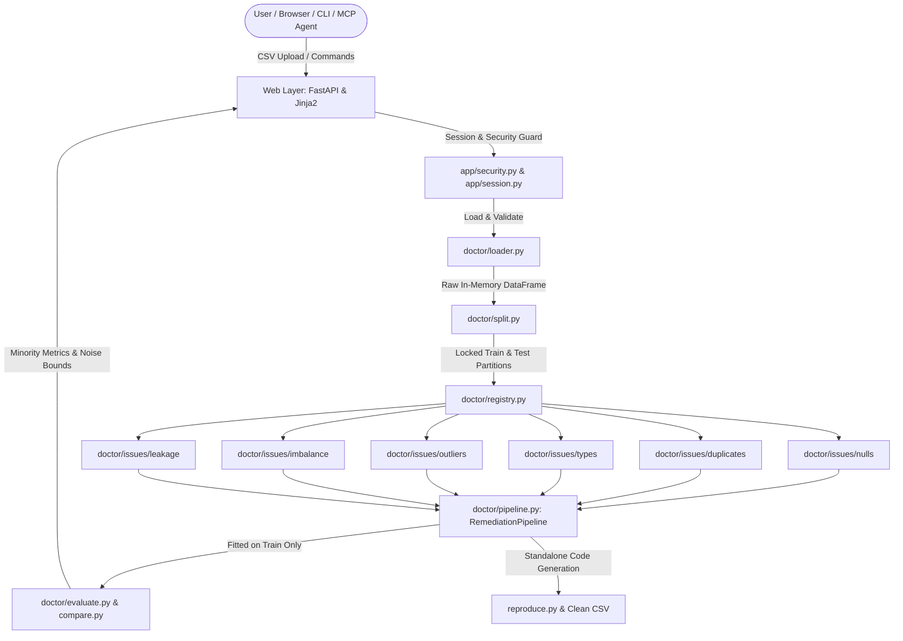
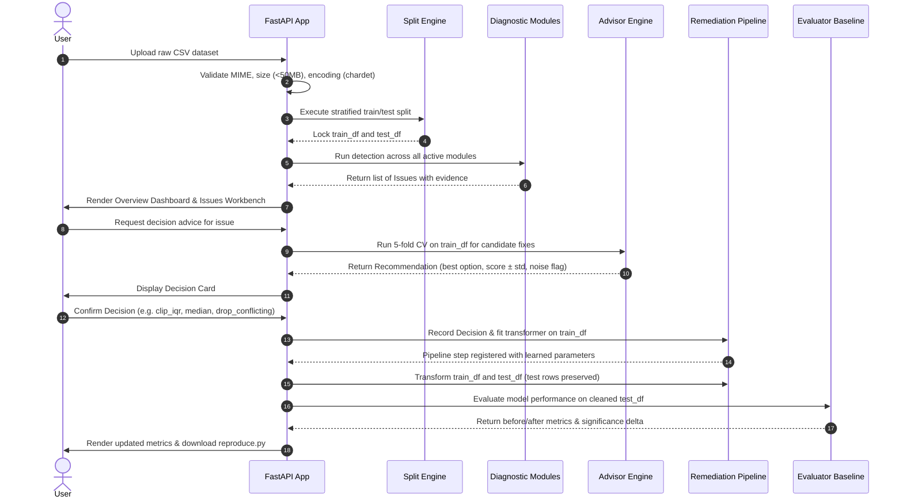

# Dataset Doctor: Architecture Blueprint

## 1. Executive Overview

Dataset Doctor is a local-first, developer-focused platform designed to audit data quality, diagnose hidden failure modes that undermine machine learning workflows, evaluate remediation alternatives with training-only cross-validation, and guarantee strict reproducibility.

Unlike generic data profilers that merely dump static distributions or auto-cleaners that silently mutate data, Dataset Doctor adheres to three foundational tenets:
1. **Split First, Protect Test Always**: Data splitting is executed before any preprocessing or diagnosis. The test partition is strictly locked—it is never resampled, never loses rows, and never participates in parameter estimation.
2. **Advise, Measure, and Ask**: Rules propose hypotheses, but 5-fold cross-validation on training data measures evidence. Every recommended transformation shows alternatives, confidence bounds ("close call", "not enough data"), and requires explicit user confirmation.
3. **Audit Trail and Exact Reproducibility**: Every accepted decision is recorded in a sequential pipeline log that exports a standalone, dependency-free `reproduce.py` script.

---

## 2. High-Level System Architecture

---

## 3. Core Subsystems and Layer Breakdown

### 3.1. Diagnostic Engine (`doctor/base.py` & `doctor/issues/*`)
Every diagnostic capability is partitioned into four decoupled modules:
- `detect.py`: Pure read-only analyzer emitting structured `Issue` dataclasses containing severity (`high`, `medium`, `low`), certainty (`certain`, `possible`), and machine-readable evidence payloads.
- `advise.py`: Evaluator formulating ranked `Recommendation` objects with rule-based shortlists, domain heuristics, and 5-fold cross-validation deltas.
- `fix.py`: Concrete `Fixer` transformer implementing `fit(train_df, decision)` and `transform(df, fitted, is_test)`.
- `explain.py`: Context-aware plain-English generator producing non-technical explanations and UI badge tokens.

### 3.2. Evaluation and Partition Integrity (`doctor/split.py` & `doctor/evaluate.py`)
- **Deterministic Splitting**: Stratified splits for classification; seeded random splits for regression.
- **Fixed Model Baseline**: Standardized RandomForest (200 trees, fixed seed) to isolate the true effect of data cleaning from hyperparameter variance.
- **Metric Honesty**: For imbalanced problems (minority share $< 20\%$), overall accuracy is labeled as unreliable; evaluation focuses on minority-class Recall, Precision, F1, and PR-AUC.
- **Noise Guard**: Deltas smaller than the cross-validation standard deviation are explicitly labeled as "within noise" or "close call" rather than claiming false superiority.

### 3.3. Remediation Pipeline & Reproducibility (`doctor/pipeline.py`)
- **Sequential Execution**: Manages user decisions across all modules in correct causal order (e.g. types $\to$ duplicates $\to$ outliers $\to$ nulls $\to$ imbalance).
- **Train-Derived Parameters**: Imputation values, clipping bounds, category encodings, and scaling factors are fitted exclusively on training data.
- **Code Generation Engine**: Translates pipeline steps into clean, readable, self-contained Python code (`reproduce.py`) that can be executed independently of Dataset Doctor.

### 3.4. Web Presentation & Interaction (`app/`)
- **Framework**: FastAPI with asynchronous endpoints, streaming uploads, and Jinja2 server-side rendering.
- **Design System**: Neo-Brutalism (`DESIGN.md`) characterized by high-contrast flat palettes, 3px solid black borders, 6px hard offset shadows, zero border-radius, and readable typography (`Space Grotesk`, `JetBrains Mono`).
- **Interactive Decision Cards**: Every issue displays diagnostic evidence, a comparison table of measured alternatives, and explicit action buttons ([APPLY RECOMMENDED], [CUSTOMIZE], [SKIP]).

### 3.5. Unified Quality & Risk Assessment Engine (`doctor/quality.py`)
- Aggregates issues from all 6 diagnostic modules into a multi-dimensional Quality & Risk Matrix.
- Evaluates Completeness, Uniqueness, Validity, Distributional Health, Class Balance, and Evaluation Integrity.
- Flags unresolved critical risks and prevents premature production model export.

### 3.6. Multi-Model Experimentation & Comparison Engine (`doctor/models.py`)
- Standardized candidate models: Random Forest baseline, Logistic Regression (L2) / Ridge, Decision Tree (max_depth=5), and Gradient Boosted Trees (LightGBM).
- Evaluates all candidate models against the exact same locked test split using the exact same preprocessing pipeline.
- Multi-metric leaderboard comparing Recall, Precision, F1, PR-AUC, ROC-AUC, and inference latency concurrently.

### 3.7. Diagnostic Error Analysis & Attribution (`doctor/diagnostics.py`, `doctor/explainability.py`)
- Confusion Matrix with raw counts and normalized class percentages.
- Error histogram and identification of worst-prediction outlier segments.
- Permutation feature importance computed strictly on training validation folds. Non-causal disclosures enforced.

### 3.8. Headless Developer Interfaces: Python SDK & CLI (`doctor/api.py`, `doctor/cli.py`)
- Reusable `doctor.*` programmatic SDK for headless scripting and Jupyter notebook integration.
- Command-line interface (`doctor profile`, `doctor audit`, `doctor evaluate`, `doctor bench`) using the exact same validation engine as the web app.

### 3.9. Model Context Protocol (MCP) Server (`doctor/mcp.py`)
- JSON-RPC over stdio server exposing Dataset Doctor tools to AI agents (Antigravity, Claude, Cursor).
- Enforces strict agent safety invariants (test set immutable, destructive operations require human confirmation).

### 3.10. Experiment Manifest & Reproducibility (`doctor/manifest.py`)
- Generates `manifest.json` capturing dataset SHA-256 hash, split seed, decision audit log, transformer parameters, model hyperparameters, and evaluation metrics.
- Automated bit-for-bit reproducibility verification harness.

---

## 4. Execution Flow: From Raw CSV to Validated Model

---

## 5. Non-Negotiable Invariants

1. **Test Set Isolation**: Under no circumstances may rows be dropped from the test set during remediation. Test set labels must never be resampled.
2. **Zero Information Leakage**: No preprocessing transformer may inspect, fit on, or aggregate statistics from validation folds or the test set.
3. **No Silent Automation**: Transformations that alter, clip, impute, or drop data must be explicitly confirmed by the user or an explicitly authorized policy.
4. **Honest Uncertainty**: If a sample is too small ($N < 500$) or a metric delta is smaller than the CV variance, the system must declare the comparison uncertain.
