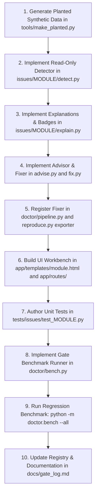

# Dataset Doctor: Feature Development & Contribution Lifecycle

## 1. Principles of Feature Development

Every feature in Dataset Doctor is developed under strict reliability and architectural constraints:
1. **Never Greenfield**: Do not rewrite existing working modules or introduce parallel architectures. Extend existing interfaces (`doctor/base.py`, `doctor/registry.py`, `doctor/pipeline.py`).
2. **Four-Part Module Architecture**: Every diagnostic capability must be decomposed into:
   - `detect.py`: Read-only issue detection.
   - `advise.py`: Recommendation heuristics and 5-fold CV measurement.
   - `fix.py`: Leak-free transformer.
   - `explain.py`: Non-technical explanations and UI badges.
3. **Planted-Data Ground Truth**: No feature is considered complete without a synthetic planted dataset generator in `tools/make_planted.py` and a corresponding `*_truth.json` ground truth specification.
4. **Automated Gate Benchmarks**: Every module must implement an automated benchmark in `doctor/bench.py` verifying precision (0 false alarms on `clean_control.csv`) and recall (100% of planted defects detected).

---

## 2. Step-by-Step Module Development Workflow

---

## 3. Planted Dataset Methodology

Planted datasets provide deterministic, reproducible test scenarios where the exact count, location, and parameters of data errors are known beforehand:
- **Known Positives**: Deterministic anomalies inserted with known indices.
- **Negative Control**: `data/samples/clean_control.csv` contains realistic edge cases (such as the ISO country code `"NA"` for Namibia, legitimate zeros, and natural skewness) that must produce 0 false alarms.
- **Truth Specification**: Stored as a companion JSON file (`data/planted/*_truth.json`) asserting the expected issue count, column, severity, and certainty.

---

## 4. Phase Progression Matrix (21-Phase Platform Roadmap)

| Phase | Module / Subsystem | Stage | Status | Benchmark Gate Criteria |
| :---: | :--- | :---: | :---: | :--- |
| **Phase 0** | Setup & Planted Baseline | Stage A | **PASS** | Synthetic generator, clean control, road accident evidence baseline |
| **Phase 1** | CSV Upload & Test Bench | Stage A | **PASS** | File validation, MIME sniff, profile generation, bench UI |
| **Phase 2** | Null Detection | Stage A | **PASS** | 850/850 planted NaNs, hidden tokens, sentinels found; 0 control false alarms |
| **Phase 3** | Split & Evaluation Engine | Stage A | **PASS** | Stratified split, locked test partition, 5-fold CV noise estimation |
| **Phase 4** | Null Advisor & Fixer | Stage A | **PASS** | Rule shortlist, CV evidence, leak-free impute, reproduce code export |
| **Phase 5** | Duplicates | Stage A | **PASS** | Exact, near, and conflicting duplicate pairs found; pre-balanced alert |
| **Phase 6** | Data Types | Stage A | **PASS** | Text numbers, ambiguous dates with user disambiguation, booleans |
| **Phase 7** | Outlier Detection | Stage A | **PASS** | 10 impossible values, unit mix-up, MAD skew guard, control immunity |
| **Phase 8** | Outlier Advisor & Fixer | Stage A | **PASS** | Rare-class extreme protection, train bounds clipping, test preservation |
| **Phase 9** | Class Imbalance Detection | Stage A | **PLANNED** | Imbalance ratio, minority shares, 90/10 & 99/1 planted detection |
| **Phase 10** | Imbalance Advisor & Fixer | Stage A | **PLANNED** | Train-only resampling (weights, oversample, SMOTE), test set untouched |
| **Phase 11** | Data Leakage Detection | Stage A | **PLANNED** | Target copies, near-perfect single features, ID leaks, time inversion |
| **Phase 12** | Leakage Advisor & Prevention | Stage A | **PLANNED** | Evidence-based column drop recommendations, time-ordered splits |
| **Phase 13** | End-to-End Pipeline Ordering | Stage A | **PLANNED** | Strict 10-step causal order verification, before/after metric diffs |
| **Phase 14** | Unified Quality Assessment | Stage B | **PLANNED** | Cross-module Risk Matrix, ML consequence mapping, unresolved tracker |
| **Phase 15** | Multi-Model Experiments | Stage C | **PLANNED** | RF, GBDT, Decision Tree, Logistic on identical locked split |
| **Phase 16** | Model Error Diagnostics | Stage D | **PLANNED** | Confusion matrix, residual distributions, error segment inspection |
| **Phase 17** | Model Explainability | Stage D | **PLANNED** | Permutation importance on validation folds, non-causal warnings |
| **Phase 18** | Python Core SDK & CLI | Stage E | **PLANNED** | Headless CLI commands (`profile`, `audit`, `evaluate`, `bench`) |
| **Phase 19** | Full Experiment Manifest | Stage F | **PLANNED** | `manifest.json`, standalone `reproduce.py`, bit-for-bit verification |
| **Phase 20** | MCP Server & Agent Tooling | Stage G | **PLANNED** | Model Context Protocol server tools with strict agent safety invariants |
| **Phase 21** | System Integration & Release | Stage G | **PLANNED** | 5 real-world datasets, 50MB under 2 min, production deployment |

