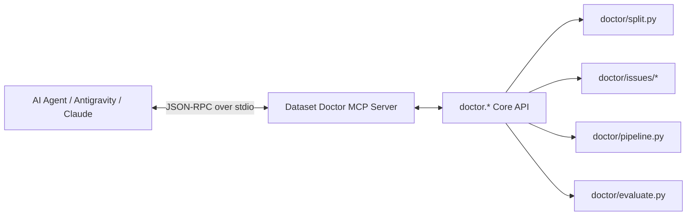

# Dataset Doctor: Model Context Protocol (MCP) Integration

## 1. Overview

The Model Context Protocol (MCP) provides an open, standardized bridge connecting Large Language Model (LLM) agents, developer IDEs (such as Antigravity, Claude Desktop, and Cursor), and local data science tools.

Dataset Doctor implements an MCP Server (`doctor.mcp`) enabling AI agents to autonomously audit dataset health, inspect diagnostic evidence, solicit evidence-backed remediation advice, and generate verified reproduction scripts—all while adhering to Dataset Doctor's strict invariants (test set isolation, train-only fitting, and human-in-the-loop confirmation).

---

## 2. Architecture & Protocol Flow



---

## 3. MCP Tools Specification

### 3.1. `doctor_load_dataset`
Loads a local CSV file into an isolated diagnostic session and performs initial schema inference.
- **Parameters**:
  - `file_path` (string, required): Absolute or workspace-relative path to the CSV file.
  - `target_column` (string, optional): Target feature name for classification or regression.
- **Returns**: Dataset shape, detected column types, memory footprint, and target class distribution.

### 3.2. `doctor_audit_quality`
Executes read-only diagnostic checks across all registered modules (`nulls`, `duplicates`, `types`, `outliers`, `imbalance`, `leakage`).
- **Parameters**:
  - `session_id` (string, optional): Active session identifier.
  - `modules` (array of strings, optional): Subset of modules to run (default: all).
- **Returns**: Array of detected `Issue` objects containing title, column, severity, certainty, and evidence payload.

### 3.3. `doctor_get_recommendations`
Solves a specific detected issue by running 5-fold cross-validation on candidate remediation options.
- **Parameters**:
  - `issue_id` (string, required): Identifier of the target issue.
  - `column` (string, required): Affected column name.
- **Returns**: Recommended remediation method, plain-English reason, tested alternatives table (with score $\pm$ std), and confidence rating (`clear`, `close call`, `not enough data`).

### 3.4. `doctor_apply_remediation`
Applies an approved remediation step to the active pipeline.
- **Parameters**:
  - `issue_id` (string, required): Module identifier.
  - `column` (string, optional): Target column.
  - `method` (string, required): Approved option identifier (e.g. `median`, `clip_iqr`, `keep_first`).
  - `params` (object, optional): Explicit transformation hyperparameters.
- **Returns**: Pipeline step status, train/test shape before and after, and confirmation of test row count preservation.

### 3.5. `doctor_evaluate_baseline`
Runs standard RandomForest evaluation on the locked test partition.
- **Returns**: Train 5-fold CV scores, test set metrics (Recall, Precision, F1, PR-AUC, Accuracy), and noise reliability flags.

### 3.6. `doctor_export_reproduce`
Generates a standalone Python script reproducing all applied remediations.
- **Returns**: Formatted Python source code and execution instructions.

---

## 4. MCP Configuration Example

To connect Dataset Doctor to an MCP client (such as Claude Desktop or Antigravity IDE), add the server entry to your `mcp_config.json`:

```json
{
  "mcpServers": {
    "dataset-doctor": {
      "command": "python",
      "args": [
        "-m",
        "doctor.mcp"
      ],
      "cwd": "f:/Dataset-Doctor",
      "env": {
        "PYTHONPATH": "f:/Dataset-Doctor"
      }
    }
  }
}
```

---

## 5. Agent Safety Invariants

When interacting via MCP, the server enforces strict autonomy boundaries:
1. **Destructive Action Confirmation**: Methods that drop rows or discard columns will return a confirmation prompt before mutating the pipeline state.
2. **Test Partition Read-Only**: The test set is completely shielded from agent-initiated transformations. Any request to drop test rows or resample test partitions is rejected with an invariant violation error.
3. **Reproducibility Guarantee**: Every action triggered through MCP is logged in the pipeline manifest, ensuring that any workflow orchestrated by an AI agent is 100% reproducible by human engineers.
